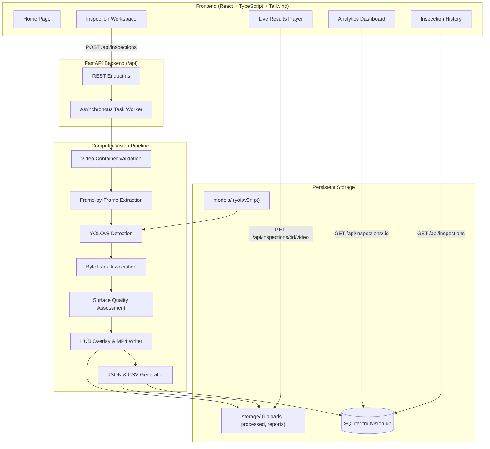

# FruitVision AI — Intelligent Multi-Fruit Detection, Tracking & Quality Inspection System

An academic Industrial project and production-style agricultural technology platform for automated multi-fruit detection, continuous multi-object tracking, and visual defect grading on video streams.

---

## 1. Project Objectives

- **Objective 1: Multi-Fruit Object Detection**: Develop a deep-learning-based computer vision pipeline for detecting multiple supported fruit categories (apples, bananas, oranges) in uploaded video streams using Ultralytics YOLOv8.
- **Objective 2: Multi-Object Tracking & Unique Counting**: Implement multi-object tracking via ByteTrack to monitor fruit movement across conveyor frames, maintaining persistent IDs and computing true object counts without duplicate frame-level increments.
- **Objective 3: Visual Quality Inspection & Analytics**: Integrate a configurable visual quality inspection module and interactive dashboard to assess visible fruit defects (blemishes, discoloration, rot) while explicitly handling uncertainty and unsupported categories.

---

## 2. Technology Stack

### Frontend
- **Framework**: React 18 with TypeScript
- **Build Tool**: Vite
- **Styling**: Tailwind CSS (Dark Navy & Emerald Agritech Theme)
- **Icons**: Lucide React
- **Data Visualizations**: Recharts
- **Router**: React Router DOM v6
- **HTTP Client**: Axios

### Backend & Computer Vision Pipeline
- **Runtime**: Python 3.12 / 3.10+
- **API Framework**: FastAPI & Uvicorn
- **Object Detection**: Ultralytics YOLOv8
- **Object Tracking**: ByteTrack (with Kalman Filter & Hungarian Association)
- **Linear Assignment**: Lapx
- **Computer Vision**: OpenCV (OpenCV-Python)
- **Deep Learning**: PyTorch & Torchvision
- **Database**: SQLite with SQLAlchemy ORM
- **Validation**: Pydantic v2 & Pydantic-Settings

---

## 3. System Architecture



---

## 4. Windows Setup & Execution Guide (PowerShell)

### Prerequisites
- Windows 10/11
- Python 3.10, 3.11, or 3.12 installed and added to `PATH`
- Node.js (v18+ or v20+) and npm installed

---

### Step 1: Open Terminal in Project Directory
```powershell
cd "d:\FRUITVISION AI"
```

### Step 2: Set Up Python Virtual Environment
```powershell
# Create virtual environment
python -m venv backend\venv

# If PowerShell script execution is restricted, run:
Set-ExecutionPolicy -Scope Process -ExecutionPolicy Bypass

# Activate virtual environment
.\backend\venv\Scripts\Activate.ps1
```

### Step 3: Install Backend Dependencies
```powershell
.\backend\venv\Scripts\pip.exe install -r backend\requirements.txt
```

### Step 4: Verify Model Weights
The base YOLOv8n model weights are located at `backend\models\yolov8n.pt`. If downloading afresh, run:
```powershell
.\backend\venv\Scripts\python.exe -c "from ultralytics import YOLO; YOLO('backend/models/yolov8n.pt')"
```

### Step 5: Start the FastAPI Backend Server
```powershell
cd "d:\FRUITVISION AI\backend"
.\venv\Scripts\uvicorn.exe app.main:app --host 0.0.0.0 --port 8000 --reload
```
Backend API will be live at:
- **API Root**: `http://localhost:8000`
- **Interactive Swagger Docs**: `http://localhost:8000/docs`
- **Health Check**: `http://localhost:8000/api/health`

---

### Step 6: Install Frontend Dependencies & Start React Server
Open a **new** PowerShell terminal tab:
```powershell
cd "d:\FRUITVISION AI\frontend"

# Install dependencies (if not already installed)
npm install

# Start development server
npm run dev
```
Frontend application will be live at:
- `http://localhost:5173`

---

## 5. Running Tests

Run backend unit tests:
```powershell
cd "d:\FRUITVISION AI\backend"
.\venv\Scripts\pytest.exe tests -v
```

Test React production build:
```powershell
cd "d:\FRUITVISION AI\frontend"
npm run build
```

Generate and process sample video:
```powershell
cd "d:\FRUITVISION AI"
.\backend\venv\Scripts\python.exe sample_videos\generate_sample_video.py
.\backend\venv\Scripts\python.exe sample_videos\test_pipeline_run.py
```

---

## 6. Supported Fruit Categories & Extensibility

| Fruit Category | Support Level | Source Model | Notes |
| :--- | :--- | :--- | :--- |
| **Apple** | Native Out-of-the-Box | COCO YOLOv8n (ID 47) | Fully verified bounding boxes & tracking |
| **Banana** | Native Out-of-the-Box | COCO YOLOv8n (ID 46) | Fully verified bounding boxes & tracking |
| **Orange** | Native Out-of-the-Box | COCO YOLOv8n (ID 49) | Fully verified bounding boxes & tracking |
| **Mango** | Extensible via fine-tuning | Custom Dataset | Training guide documented in `docs/model_training.md` |
| **Grape** | Extensible via fine-tuning | Custom Dataset | Training guide documented in `docs/model_training.md` |
| **Strawberry** | Extensible via fine-tuning | Custom Dataset | Training guide documented in `docs/model_training.md` |
| **Pineapple** | Extensible via fine-tuning | Custom Dataset | Training guide documented in `docs/model_training.md` |
| **Pear** | Extensible via fine-tuning | Custom Dataset | Training guide documented in `docs/model_training.md` |

---

## 7. Troubleshooting

- **`PermissionError / getaddrinfo failed`**: Standard sandbox environments isolate network traffic. Ensure you run npm and pip install commands with active network access or outside sandboxed mode.
- **`ModuleNotFoundError: No module named 'lap'`**: Ultralytics ByteTrack requires `lapx`. Run `pip install lapx` inside the virtual environment.
- **`npm.ps1 cannot be loaded`**: PowerShell restricts script execution by default. Use `cmd /c npm <command>` or run `Set-ExecutionPolicy -Scope Process -ExecutionPolicy Bypass`.
- **Codec Warnings**: OpenCV defaults to `mp4v`. If browser playback displays black frames, download the video or view via standard media players (VLC, Windows Media Player) or ensure WebM/H264 codec support.

---

## 8. Definition of Done Checklist

- [x] Milestone 1: YOLOv8 fruit detection, ByteTrack tracking, and annotated MP4 video generation verified.
- [x] Milestone 2: Polished React web frontend, inspection workspace, results player, analytics dashboard, report downloads, and SQLite history verified.
- [x] Backend tests: 8/8 unit tests passing.
- [x] Frontend build: TypeScript & Vite production build passes with zero errors.
- [x] Documentation & Windows PowerShell commands complete.

