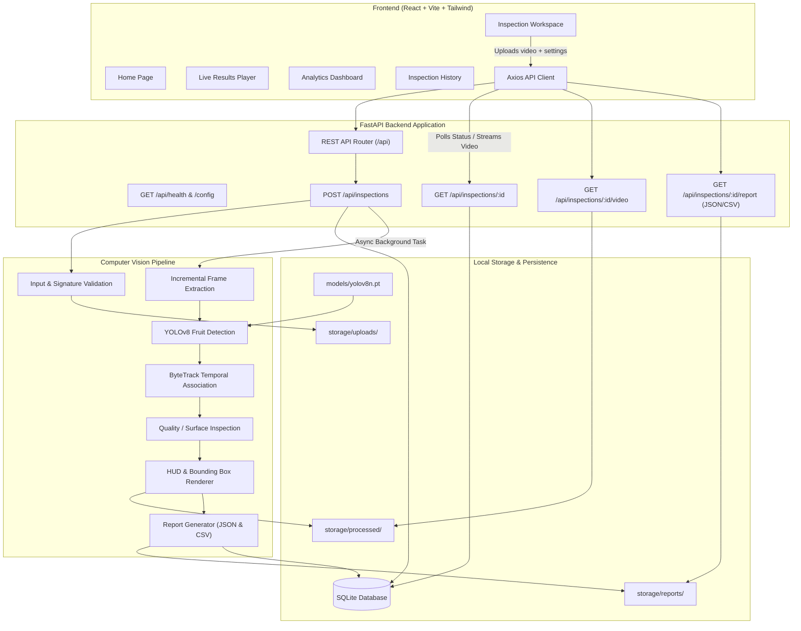

# FruitVision AI — System Architecture

FruitVision AI is an agricultural computer vision web platform designed to detect, continuously track, count, and evaluate the quality of fruits on conveyor belts or post-harvest sorting lines.

## Architecture Diagram

## Modular Components

1. **API Layer (`app/api/routes.py`)**:
   Provides RESTful endpoints for health checks, system configurations, asynchronous inspection execution, cancellation, and artifact downloads.

2. **Detection Service (`app/services/detection_service.py`)**:
   Singleton service that manages the Ultralytics YOLO model. Preloaded on startup to prevent per-frame model reloads. Detects recognized fruit categories with configurable confidence thresholds.

3. **Tracking Service (`app/services/tracking_service.py`)**:
   Implements ByteTrack association. Tracks bounding box centroids across time using Kalman filtering and Hungarian matching. Preserves track-level histories and ensures unique count incrementation.

4. **Quality Inspection Service (`app/services/quality_service.py`)**:
   Operates on cropped fruit bounding boxes. Supports deep learning classification adapters (PyTorch) or transparent surface color anomaly heuristics with uncertainty flags.

5. **Video Processor (`app/services/video_processor.py`)**:
   Coordinates streaming frame extraction, OpenCV video writing with HUD telemetry, and cancellation checks.

